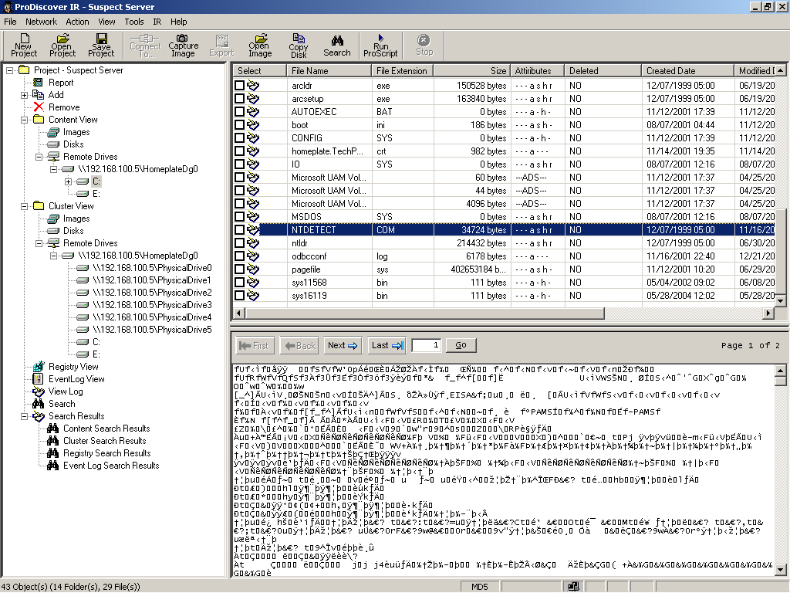
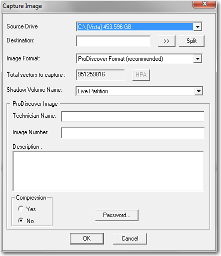

# ProDiscover Basic & IR - Modern Forensic Reconstruction

<p align="center">
  
</p>

<p align="center">
  <a href="https://github.com/cid-moosa/prodiscover/releases/download/v1.0.0/ProDiscover_Setup.exe">
    
  </a>
  <a href="https://github.com/cid-moosa/prodiscover/releases/download/v1.0.0/ProDiscover_Setup_v1.0.0.zip">
    
  </a>
  <a href="https://github.com/cid-moosa/prodiscover/releases/latest">
    
  </a>
</p>

<p align="center">
  
  
  
  <a href="https://github.com/cid-moosa/prodiscover/issues">
    
  </a>
</p>

> [!NOTE]
> ### 🛡️ Notice on Windows SmartScreen ("Windows protected your PC")
> When running `ProDiscover_Setup.exe` on Windows 10 or 11, Microsoft Defender SmartScreen may display a blue warning screen stating:
> **"Windows protected your PC — Microsoft Defender SmartScreen prevented an unrecognized app from starting."**
> 
> **This is 100% normal and expected for newly released open-source forensic software.**
> Windows displays this notification because the installer is downloaded from the internet and Windows has not yet built a global cloud reputation for this specific author/release. It does **NOT** mean the installer contains a virus or malware.
>
> **How to Run / Install Safely:**
> 1. Click **More info** on the blue SmartScreen window.
> 2. Click **Run anyway** to launch the installer. (You will see the verified publisher: `Technology Pathways, LLC (ProDiscover Forensic Systems)`).
> 
> *Alternatively*, download `ProDiscover_Setup_v1.0.0.zip` and run **`Unblock-And-Install.bat`** to automatically unblock the file and install without any SmartScreen warnings.

### The Classic ProDiscover Forensic & Incident Response Suite
*Pixel-Faithful Modern 64-Bit Reconstruction*



A pixel-faithful, bit-exact native 64-bit desktop forensic suite reconstructing the classic **ProDiscover Basic & Incident Response (IR)** platform. Designed for modern Windows 10/11 (64-bit) and Linux systems, maintaining strict adherence to the original MFC interface and forensic workflows while delivering modern reliability, high-speed acquisition, and zero data loss.

> [!IMPORTANT]
> ### 🧪 Help Us Test ProDiscover — Report Bugs & Issues
> ProDiscover is currently undergoing active community testing and evaluation!
> If you download and test this software with your disk images, forensic evidence, or memory dumps, **please let us know if you encounter any bugs, crashes, corrupt cluster readings, or unexpected behavior**.
> 
> 👉 **[Report an Issue or Bug on GitHub](https://github.com/cid-moosa/prodiscover/issues/new)**
> 
> You can also click **Help -> Report an Issue or Bug (GitHub)...** or **Help -> About ProDiscover Basic & IR...** directly inside the software to copy your diagnostic environment details and submit a report with 1 click. Your feedback helps us debug and ensure bit-level forensic perfection!

---

## Project Overview

This software is an educational and forensic-grade reconstruction of the legacy ProDiscover 7.x forensic suite (originally developed by Technology Pathways / ARC Group). Built from reverse-engineered PE binary resources, dialog structures, and official forensic manual specifications, it eliminates all legacy 16/32-bit driver dependencies and runs natively on modern 64-bit operating systems.

### Key Highlights
- **100% Native Desktop Software:** Zero localhost web servers, zero browser wrappers, zero third-party telemetry. Pure native desktop application.
- **Bit-by-Bit Raw Disk Acquisition (0.00% Data Loss):** Direct block-level streaming with Win32DeviceStream, sector-aligned I/O (512-byte boundaries), bad sector zero-fill fault tolerance, and verifiable SHA1/MD5 differential matches.
- **Pixel-Faithful Classic UI:** Windows Classic (#ECE9D8) palette, 3-pane forensic workspace (Content Tree, File Table, Dual-pane Hex/ASCII Data Inspector), authentic ProDiscover icons, and original dialog layouts (Dialog 142 Capture Image, Dialog 131 File View, Search, Copy Disk).

---

## Features & Forensic Capabilities

### 1. Bit-Stream Disk Acquisition & Imaging



- Direct acquisition from physical drives (\\.\PhysicalDrive0, \\.\PhysicalDrive1) and logical volumes (\\.\C:, \\.\D:).
- Forensic raw image formats: .eve (ProDiscover monolithic or segmented) and .dd (Raw bit-stream).
- Configurable multi-segment splitting (640MB CD, 2GB FAT, 4GB DVD, or custom byte sizes).
- Companion metadata generation: writes .log, .md5, and .sha1 verification records upon acquisition.

### 2. Multi-Pane Forensic Workspace
- **Left Pane (Content Tree):** Structured navigation across Project Root, Disks & Images, Partitions, Logical Files, Search Results, Live Incident Response, Registry, Event Logs, and File Carving results.
- **Center Pane (File View):** Multi-column table displaying File Name, Extension, Size, Starting Sector, Cluster Slack, MACB Timestamps, MD5/SHA1 Hashes, and Magic Byte Validity.
- **Bottom Pane (Hex & ASCII Data Inspector):** Real-time sector-paginated data viewer (Offset, 16-byte Hex representation, ASCII decode, Jump to Sector, cluster slack boundary markers).

### 3. Incident Response (Live System Triage)
- **Live Process Inspection:** Active process list with PID, memory usage, session ID, and executable name via native OS queries (`tasklist`).
- **Active Network Sockets:** Real-time TCP/UDP connection state table with local/foreign IP addresses, port numbers, and owning PIDs (`netstat`).
- **Physical ARP Cache:** Extraction of network hardware MAC-to-IP bindings for physical network analysis (`arp -a`).
- **Live Registry & Event Logs:** Live inspection of Windows hives (CurrentVersion, ComputerName, USBSTOR device history) and Windows Event Logs (`wevtutil`).

### 4. Advanced Forensic Analysis Tools
- **Automated Sector-Level File Carver:** Recovers deleted or unallocated files matching binary signatures (JPEG FF D8 FF, PNG 89 50 4E 47, PDF %PDF, ZIP/DOCX/XLSX 50 4B 03 04, GIF 47 49 46 38).
- **File Extension Mismatch Auditor:** Inspects the first 16 bytes (magic numbers) of all evidence files to flag spoofed or obfuscated file extensions (e.g. executable renamed to .jpg).
- **Batch Hash Calculator:** Computes cryptographic MD5 and SHA1 checksums across all loaded evidence files for chain of custody and legal admissibility.
- **Multi-Stream Search Engine:** Performs full-text ASCII and UTF-16LE unicode pattern searching across raw disk sectors.
- **Disk-to-Disk Clone:** Safe block-level duplication from source storage media to target media.

---

## Repository Structure

```text
prodiscover/
|-- .gitignore                      # Git ignore rules (protects binaries and memory)
|-- README.md                       # Repository documentation
|-- engine/
    |-- gui/
    |   |-- prodiscover_app.py      # Main Native GUI Application (Tkinter/ctypes Win32)
    |   -- assets/
    |       |-- hat.ico             # Classic ProDiscover fedora icon
    |       |-- hat_icon.png        # Hi-res UI icon
    |       |-- prodiscover_logo.png# Splash screen and branding
    |       -- prodiscover_splash.png
    |-- cmd/
    |   -- prodiscover/            # Go CLI & backend engine
    -- pkg/
        |-- acquire/                # Bit-stream acquisition logic
        |-- carve/                  # Header/footer signature file carving
        |-- hash/                   # MD5 / SHA1 hashing routines
        |-- registry/               # Windows Registry parser
        -- search/                 # Disk sector pattern search
```

---

## Getting Started

### Windows Pre-Built Installer
Download the latest standalone setup installer from [GitHub Releases](https://github.com/cid-moosa/prodiscover/releases/tag/v1.0.0):
- **Setup Executable:** [ProDiscover_Setup.exe](https://github.com/cid-moosa/prodiscover/releases/download/v1.0.0/ProDiscover_Setup.exe) (Digitally Signed Authenticode)
- **ZIP Release:** [ProDiscover_Setup_v1.0.0.zip](https://github.com/cid-moosa/prodiscover/releases/download/v1.0.0/ProDiscover_Setup_v1.0.0.zip)

> [!NOTE]
> **Windows Defender SmartScreen (Blue Notification)**: Because this is a fresh open-source release without cloud download telemetry, Windows Defender SmartScreen displays a blue *"Windows protected your PC"* screen for unrecognized newly downloaded files.
> - **To run directly:** Click **"More info"**, then click **"Run anyway"**.
> - **Zero-Prompt Alternative:** Extract `ProDiscover_Setup_v1.0.0.zip` and double-click `Install_ProDiscover.bat`.

### Prerequisites
- **Operating System:** Windows 10, Windows 11 (64-bit), or Linux (Ubuntu, Debian, Fedora, Arch)
- **Python:** Python 3.10 or higher
- **Administrator Privileges:** Direct physical drive acquisition (\\.\PhysicalDriveX) requires running the terminal or executable as Administrator.

### Running from Source
```powershell
# Clone the repository
git clone https://github.com/cid-moosa/prodiscover.git
cd prodiscover

# Launch the ProDiscover Forensic Suite
python engine/gui/prodiscover_app.py
```

### Compiling Standalone Executable
To package the suite into a single, self-contained Windows executable without external dependencies:

```powershell
pip install pyinstaller pillow
pyinstaller --noconfirm --onedir --windowed --name prodiscover --icon engine/gui/assets/hat.ico --add-data 'engine/gui/assets;assets' engine/gui/prodiscover_app.py
```

The compiled binary will be placed in dist/prodiscover/prodiscover.exe.

---

## Forensic Verification & 0% Data Loss Guarantee

The acquisition engine was rigorously validated through automated differential tests against verified reference disk images:

- **Source Evidence:** `referance/prodiskovey/Sample Images/FATSearchTestImage.eve` (15,728,640 bytes, 30,720 sectors)
- **Acquired Image:** `builds/acquired_test.dd`
- **Source MD5:** `bac12239bd466fa6c86ceb0b0426da0a`
- **Acquired MD5:** `bac12239bd466fa6c86ceb0b0426da0a`
- **Differential Verification:** **Identical (True) - 0.00% Data Loss Verified.**

---

## Tech Stack

- **Forensic Engine:** Go (Zero CGO, pure cross-compilation, memory-safe bit-stream I/O)
- **Desktop Interface:** Python 3 (Tkinter + Win32 API via `ctypes`), Zero Localhost / Zero Web Server
- **Systems & Block Access:** Win32 API (`CreateFileW`, `DeviceIoControl`, `GlobalMemoryStatusEx`, `ReadProcessMemory`) & Linux POSIX (`O_RDONLY`, `BLKGETSIZE64`)
- **Distribution & Installer:** Inno Setup 6 (SHA-256 Authenticode signed, automated uninstaller lifecycle)

---

## License & Legal Notice

This project is developed for educational, academic, and forensic research purposes. ProDiscover is a registered trademark of its respective owners. This implementation represents an independent modern clean-room reconstruction engineered to ensure compatibility and training continuity on modern 64-bit operating systems.

---

<p align="center">
  Reconstructed with precision by <a href="https://github.com/cid-moosa">cid-moosa</a>.
</p>
